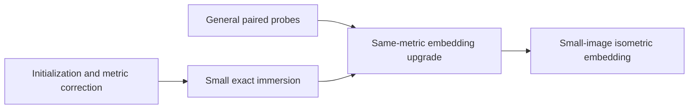

# Reading the proof

## 1. Read the complete result

[MainTheorem.lean](../MainTheorem.lean) states and proves
`GlobalEmbedding.small_image_isometric_embedding` with its full quantifiers.
Its inputs are a closed smooth parallelizable source of dimension at least
three, a smooth Riemannian metric, and a positive radius.

The output is one map `F`, together with:

| Lean conclusion | Mathematical meaning |
| --- | --- |
| `ContMDiff ... ∞ F` | F is smooth |
| `inducedMetric ... F = ... metric0 ...` | F induces the given metric exactly |
| `Function.Injective (mfderiv ... F x)` | The differential is injective at every point |
| `PhaseRegular ... F hF` | F has the paper's phase-regularity property |
| `IsEmbedding F` | F is a topological embedding |
| `Set.range F ⊆ Metric.ball 0 r` | The whole image lies in the requested open ball |

The public theorem directly applies the proved
[`GlobalEmbedding.Main.endpoint_main`](../src/Main/OriginalUpgradeMain.lean).
Its complete statement is also defined, independently of the proof producers,
as [`EndpointMainTarget`](../src/Main/EndpointStatements.lean).

## 2. Follow the final argument

The final argument is in
[SmallImmersionUpgrade.lean](../src/Main/SmallImmersionUpgrade.lean).

1. Obtain an exact, phase-regular immersion of the given metric whose image
   lies in the radius-r/2 ball.
2. Apply the same-metric embedding upgrade to that immersion. Choose its
   C² tolerance small enough to control the Euclidean C⁰ displacement;
   the coordinate-to-Euclidean comparison constant is included explicitly.
3. The resulting map is an embedding and still induces the same metric.
   Its displacement and the original radius bound put its image in the
   radius-r ball.



[OriginalUpgradeMain.lean](../src/Main/OriginalUpgradeMain.lean) supplies the
actual native probe provider used in this assembly, through the general
construction in [GeneralOriginalProbes.lean](../src/Main/GeneralOriginalProbes.lean).
The analytic providers used by intermediate lemmas are constructed internally
before the final theorem is applied to the source manifold and metric.

## 3. Read the major ingredients

| Ingredient | Main entry |
| --- | --- |
| Small exact immersions | [SmallExactImmersion.lean](../src/Foundations/GlobalEmbedding/Targets/SmallExactImmersion.lean) |
| Initialization | [ColoredApproximation.lean](../src/Foundations/GlobalEmbedding/Targets/ColoredApproximation.lean) |
| Finite positive increments | [FinitePositiveIncrements.lean](../src/Foundations/GlobalEmbedding/Targets/FinitePositiveIncrements.lean) |
| General paired probes | [GeneralOriginalProbes.lean](../src/Main/GeneralOriginalProbes.lean) |
| Probe statement and estimates | [GeneralEndpointStatements.lean](../src/Main/GeneralEndpointStatements.lean), [GeneralExactProbeFamily.lean](../src/Main/GeneralExactProbeFamily.lean) |
| Same-metric embedding upgrade | [OriginalUpgradeMain.lean](../src/Main/OriginalUpgradeMain.lean), `original_sameMetric_phase_embedding` |
| Finite-parameter avoidance | [FiniteParameterAvoidance.lean](../src/Foundations/GlobalEmbedding/Targets/FiniteParameterAvoidance.lean) |
| Phase regularity | [PhaseRegular.lean](../src/Foundations/GlobalEmbedding/Paper/PhaseRegular.lean) |
| Induced metric | [IsometricMap.lean](../src/Foundations/GlobalEmbedding/Paper/IsometricMap.lean) |
| Parallelizability | [Parallelizable.lean](../src/Foundations/GlobalEmbedding/Paper/Parallelizable.lean) |

The probe construction produces a jointly smooth same-metric family from
the original immersion and finite legal wave list. Its actual normal-bundle
identification and response estimates feed the incidence and avoidance
arguments in `src/Upgrade/`. The dimension-three case and disconnected
sources are included in the upgrade.

The small immersion uses the actual metric-correction constructions in
`src/Repair/`. The main argument consumes the quantitative constructions
needed for this route; its final input list is visible in `MainTheorem.lean`.

## 4. Reproduce the Lean check

From the repository root, with the pinned toolchain installed:

```sh
lake exe cache get
lake build
lake env lean MainTheorem.lean
```

The explicit public theorem has a proof term checked by Lean. Its final
`#print axioms` command prints the foundational axiom closure. The established
main endpoint additionally passed an independent official default-kernel
comparison against the separately frozen original statement; the immutable
[verification record](https://github.com/yang-wc25/global-embedding/blob/e81c8183cb1d6c7ccd6ef7643fa292ec31afe991/coord/reviews/thm-main-acceptance.json)
is kept in the original development repository.
